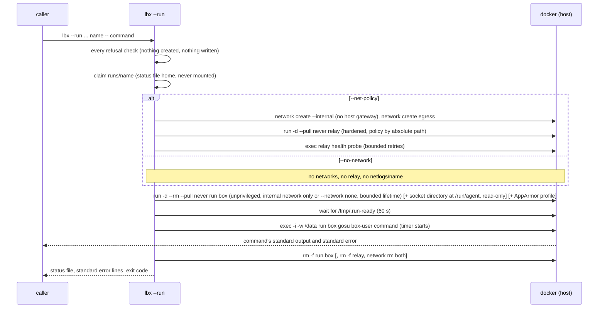

# Unattended runs (`lbx --run`)

LLM copy: [llm/unattended-runs_llm.md](llm/unattended-runs_llm.md).
Decision records: [adr/012](adr/012-unattended-runs-stricter-mode.md), and
[adr/014](adr/014-unattended-runs-socket-directory-and-no-network.md) for the
socket directory, no-network runs and the AppArmor option.

## What an unattended run is for

An unattended run is one invocation of `lbx --run`: it creates a box for
one command, runs that command once with no terminal, returns the
command's exit code, and removes the box. It is meant for scheduled agent
jobs (documentation drift checks, health reports, knowledge-base
refreshes) where nobody watches the terminal and part of the job's input
is text the operator does not control: repository contents, log lines,
chat messages. Assume that text can steer the agent into running any
command inside the box.

For that reason an unattended run does not use the interactive defaults.
Its box (the **run box**) is narrower than an interactive docker session: not
privileged, four capabilities, no inner docker, no sudo, no network
except a policy-checked relay (or no network at all, with
[`--no-network`](#runs-with-no-network---no-network)), no host variable it was not given by
name, and a dedicated data directory instead of your working tree (each
with its tests in [the comparison below](#run-box-compared-with-an-interactive-docker-session)).
Three opt-in additions change that picture, each on request only: a
[socket directory](#talking-to-the-caller-through-sockets---socket-dir)
through which the command reaches services you run, a run with no
network, and an [AppArmor profile](#running-under-the-llm-in-a-box-apparmor-profile---apparmor-profile)
meant to be narrower than docker's default.

Security model statement — not a tested claim: this narrows what a
steered agent can reach, but llm-in-a-box remains host isolation, not an
adversarial sandbox. The run box shares the host kernel and has no user
namespace, so a kernel escape reaches the host. Run unattended jobs inside
a disposable virtual machine that holds only what the job needs (see
[Residual risks](#residual-risks)).

Interactive sessions are unchanged in every scenario the stored baseline
covers: creating a docker or sysbox session (plain, with a policy, with
`GH_TOKEN` set, with `--ports`), attaching to one, and starting a stopped
one make the same docker calls and print the same output as before
unattended runs existed, apart from one read-only label query before
attaching to or starting an existing container
(`tests/test_llm_in_a_box_run.sh` REG1, REG3). `lbx --denied` makes one
more query, only for a deny log that is a symbolic link, and still prints
an interactive session's linked deny log as before
(`tests/test_llm_in_a_box_run.sh` REG4). vm sessions and the `--device`,
`--fuse`, `--publish` and `--vm-web-port` options are outside that
baseline.

Unattended runs need a Linux host: a host without `setpriv --pdeathsig`
(from util-linux; setpriv exists only on Linux, so any macOS or Windows host) is
refused (`tests/test_llm_in_a_box_run.sh` RUN39).

Test references below name the file and the check id. `RUN` and `REG`
checks run the real launcher against a fake docker; `VRUN` checks run it
against real docker, the built images and the real relay.

## The command line

```
lbx --run --runtime docker (--net-policy <file> | --no-network) --data <dir> --timeout <seconds> \
    [--socket-dir <dir>] [--apparmor-profile] [--env NAME]... <name> -- <command> [args...]
```

| Part | Meaning |
|------|---------|
| `--run` | Makes the invocation an unattended run. |
| `--runtime docker` | Required and must be `docker`; sysbox and vm are refused (`tests/test_llm_in_a_box_run.sh` RUN2). |
| `--net-policy <file>` | A regular file, readable, valid, with mode `enforce` or `locked` (`tests/test_llm_in_a_box_run.sh` RUN1, RUN57). It may set `idle_timeout_seconds` (see [Idle timeout and connection cap](#idle-timeout-and-connection-cap)). Exactly one of `--net-policy` and `--no-network` is required: both together (in either order, also with an empty `--net-policy ''`) are refused as "--no-network cannot be combined with --net-policy", before the configuration and the policy are read, and neither is refused as "--run needs --net-policy with mode enforce or locked, or --no-network" (`tests/test_llm_in_a_box_run.sh` RUN103). |
| `--no-network` | The run box gets no network at all, only loopback (on some hosts the kernel also adds its unused tunnel devices, down and without an address), and no relay is started; see [Runs with no network](#runs-with-no-network---no-network). Takes no value (`tests/test_llm_in_a_box_run.sh` RUN103, RUN104). |
| `--socket-dir <dir>` | Optional, at most once. A directory of Unix sockets you serve, mounted read-only at `/run/agent`; see [Talking to the caller through sockets](#talking-to-the-caller-through-sockets---socket-dir) (`tests/test_llm_in_a_box_run.sh` RUN98, RUN99). |
| `--apparmor-profile` | Optional, takes no value. Runs the run box under the llm-in-a-box AppArmor profile for its mode; see [Running under the llm-in-a-box AppArmor profile](#running-under-the-llm-in-a-box-apparmor-profile---apparmor-profile) (`tests/test_llm_in_a_box_run.sh` RUN109, RUN110). |
| `--data <dir>` | Required. The **data directory**: a host directory mounted at `/data`, subject to the [data-directory rules](#the-data-directory); a run without it is refused (`tests/test_llm_in_a_box_run.sh` RUN56). |
| `--timeout <seconds>` | Required, a whole number from 1 to 604800 (seven days) (`tests/test_llm_in_a_box_run.sh` RUN9). |
| `--env NAME` | Repeatable. Makes the host variable `NAME` available to the command; see [Passing variables](#passing-variables---env). |
| `<name>` | The **run name**: the name of the run box, `[A-Za-z0-9][A-Za-z0-9._-]*`, at most 128 characters (`tests/test_llm_in_a_box_run.sh` RUN7; `tests/verify-run-unattended.sh` VRUN16). Every run needs a run name not used before on that host (`tests/test_llm_in_a_box_run.sh` RUN4, RUN22). |
| `-- <command> [args...]` | The command, required (`tests/test_llm_in_a_box_run.sh` RUN6). Everything after `--` is passed element for element, with no shell re-parsing it; `lbx`'s own flags or a second `--` inside it are just arguments (`tests/test_llm_in_a_box_run.sh` RUN15; `tests/verify-run-unattended.sh` VRUN11). |

The command runs as the **box user**, the account inside the run box that
carries your host user name, user id and group id, with `/data` as its
working directory (`tests/test_llm_in_a_box_run.sh` RUN12;
`tests/verify-run-unattended.sh` VRUN2 with a user id other than 1000 and
a group id that collides with an image group).

`--data`, `--env` and `--timeout` without `--run` are refused with exit 1,
and `--` without `--run` fails with `ERROR: Unknown option: --` and exit 1,
as before (`tests/test_llm_in_a_box_run.sh` REG2). `--socket-dir`,
`--no-network` and `--apparmor-profile` without `--run` are refused with
exit 1 and "... is only valid with --run.", creating and writing nothing
(`tests/test_llm_in_a_box_run.sh` RUN101, RUN110). A literal `--run` given as the
value of another option (for example `--net-policy --run` or
`--socket-dir --run`) is that value and does not start an unattended run
(`tests/test_llm_in_a_box_run.sh` RUN38, RUN42, RUN101).

### A complete example

```bash
# Inputs go into a fresh directory outside your home directory.
data="$(mktemp -d)"
cp ./docs/*.md "$data/"

# A run name used only once on this host.
run="docs-drift-$(date +%Y%m%d-%H%M%S)-$$"
state="${LBX_STATE_DIR:-$HOME/.llm-in-a-box}"

# The policy lives on the host, outside the data directory. lbx copies the
# shipped policies there only on its first interactive use, so put one
# there yourself if it is missing (run from the llm-in-a-box checkout).
policy="$HOME/.config/llm_in_a_box/locked.json"
[ -f "$policy" ] || install -D -m 644 net-policies/locked.json "$policy"

export ANTHROPIC_API_KEY=...        # named below with --env, so it reaches the command
lbx --run --runtime docker \
    --net-policy "$policy" \
    --data "$data" --timeout 1800 \
    --env ANTHROPIC_API_KEY \
    "$run" -- claude --dangerously-skip-permissions -p "Compare /data/*.md and write /data/report.md"
rc=$?

# The outcome: read the status file, not standard error.
cat "$state/runs/$run/status"            # for example: status=exited code=0
# The deny log: open it without following links.
dd if="$state/netlogs/$run/deny.log" iflag=nofollow status=none

# Collect outputs from $data (see "The caller contract"), then clean up.
rm -rf -- "$data" "$state/netlogs/$run" "$state/runs/$run"
```

`lbx` copies the shipped policies (`open`, `enforce`, `locked`) to
`~/.config/llm_in_a_box/` on its first interactive use (for example
`lbx --list`); an unattended run never does, and leaves your home
directory unchanged (`tests/test_llm_in_a_box_run.sh` RUN68). On a host
where `lbx` never ran interactively, copy `net-policies/locked.json` or
`net-policies/enforce.json` there yourself, as the example does, or pass
a policy file of your own.

Operational guidance — not a tested claim: keep the allowlist per job and
as small as the job allows.

## How it works



A [no-network run](#runs-with-no-network---no-network) skips the
networks, the relay and its probe, and at cleanup removes only the run
box (`tests/test_llm_in_a_box_run.sh` RUN104, RUN105). A socket
directory and the AppArmor profile each add to the run box's `docker run`
only (`tests/test_llm_in_a_box_run.sh` RUN98, RUN109).

1. **Checks.** Every refusal happens before any docker resource is
   created and before any file is written: each refusal check compares
   the state directory, the configuration directory, `HOME`, the data
   directory and the working directory before and after, and allows only
   read-only docker calls (every refusal check in
   `tests/test_llm_in_a_box_run.sh`). A refusal
   ends with exit 125 and `lbx-run: status=refused code=125` as the last
   line on standard error. The exception is the name claim itself, which
   creates the state directory, `runs/` and `runs/<name>` when they are
   missing (and any missing ancestors of the state directory, which stay)
   and, on a refusal there, removes those three it created only while
   they are empty (`tests/test_llm_in_a_box_run.sh` RUN92, RUN94, RUN96): when another process's `.claim` or status file appears
   in `runs/<name>` between the launcher's `mkdir` and its claim, or a
   concurrent run's entry is already in `runs/` or `runs/<name>`, those
   directories stay, with the other process's entry
   (`tests/test_llm_in_a_box_run.sh` RUN44, RUN45, RUN53, RUN88, RUN90).
2. **Name claim.** The run creates `$LBX_STATE_DIR/runs/<name>` and
   claims the name there with one exclusive create; of two runs with the
   same name started together, exactly one proceeds
   (`tests/test_llm_in_a_box_run.sh` RUN37). See
   [Run names](#run-names).
3. **Networks, relay, run box.** An internal network created without a
   host gateway address, an egress network for the relay, the relay on both, its health
   probe, then the run box on the internal network only. The order and
   every protection in these calls are pinned by
   `tests/test_llm_in_a_box_run.sh` RUN12 and RUN67; on real docker, the
   box cannot reach a host listener through the internal network's first
   address, while a plain internal network can
   (`tests/verify-run-unattended.sh` VRUN4; what that check does not cover
   is under [Known limits](#known-limits)). The relay must answer its
   health probe within ten attempts, one second apart, or the run ends as
   a setup failure (`tests/test_llm_in_a_box_run.sh` RUN63); so does a
   relay whose address cannot be read (`tests/test_llm_in_a_box_run.sh`
   RUN62).
4. **Readiness.** The command starts only after the entrypoint has
   finished: user remap, ownership of the home directory, proxy settings,
   removal of the sudoers file and of the docker group membership. The
   entrypoint writes `/tmp/.run-ready` as its last step and `lbx` waits
   for it (`tests/test_llm_in_a_box_run.sh` RUN12;
   `tests/verify-run-unattended.sh` VRUN2, VRUN9). A box that is not ready
   after 60 seconds ends the run as a setup failure
   (`tests/test_llm_in_a_box_run.sh` RUN33).
5. **The command.** Exactly one `docker exec -i` (no terminal) as the box
   user in `/data`. Standard input is forwarded unchanged
   (`tests/test_llm_in_a_box_run.sh` RUN32;
   `tests/verify-run-unattended.sh` VRUN3). The timer starts with the
   command, so the timeout measures the command, never the setup
   (`tests/test_llm_in_a_box_run.sh` RUN28).
6. **Cleanup.** The run box first (which ends the command inside it),
   then the relay, then both networks, each only when it carries this
   run's identity label; then the outcome is written. See
   [Cleanup](#cleanup).

## Run box compared with an interactive docker session

| Aspect | Interactive docker runtime | Run box | Tests |
|---|---|---|---|
| Privilege | `--privileged` | Not privileged; `--cap-drop ALL` plus only `CHOWN`, `DAC_OVERRIDE`, `SETGID`, `SETUID`; no new privileges; docker's default seccomp profile, and its default AppArmor profile unless `--apparmor-profile` is given; the command itself runs with no effective capability | `tests/test_llm_in_a_box_run.sh` RUN12; `tests/verify-run-unattended.sh` VRUN2 |
| Inner docker | dockerd started, socket present, user in the docker group | No dockerd, never started; no socket; not in the docker group; `docker info` fails | `tests/verify-run-unattended.sh` VRUN2, VRUN10 |
| sudo | Passwordless for the box user | The sudoers file is deleted; `sudo -l` lists nothing; `sudo` and `su` fail | `tests/verify-run-unattended.sh` VRUN2 |
| Network wall | Optional | Required, mode `enforce` or `locked`, unless the run has no network at all (`--no-network`) | `tests/test_llm_in_a_box_run.sh` RUN1, RUN103 |
| Ways out | Relay when walled; otherwise the network | Only the relay, addressed by its numeric address: public names do not resolve, and no connection reaches a public address (1.1.1.1 is tried), a host listener through the network's first address, the metadata address 169.254.169.254, or a public internet protocol version 6 (IPv6) address; IPv6 is disabled with the `all` setting (link-local IPv6 and the interface's own setting are not checked: [Known limits](#known-limits)). With `--socket-dir`, also the sockets of the socket directory, live channels to your servers | `tests/test_llm_in_a_box_run.sh` RUN12; `tests/verify-run-unattended.sh` VRUN4, VRUN5, VRUN9, VRUN20, VRUN24 |
| Name resolution | Docker's embedded resolver, forwarding outside names | Docker-network names only (the relay's name resolves); outside names fail | `tests/verify-run-unattended.sh` VRUN4 |
| Relay | Default container settings | Runs as your user id and group id with a private `/tmp`, on the run's two networks only; all capabilities dropped, no new privileges, read-only root, policy mounted by absolute path, must answer a health probe first, no proxy variable from the docker client's configuration | `tests/test_llm_in_a_box_run.sh` RUN12, RUN16, RUN63, RUN67; `tests/verify-run-unattended.sh` VRUN6, VRUN13 |
| Host variables | `GH_TOKEN` forwarded automatically | Only names given with `--env`, on the command's exec only; no proxy variable from the docker client's configuration | `tests/test_llm_in_a_box_run.sh` RUN23, RUN26; `tests/verify-run-unattended.sh` VRUN6 |
| Mounted at `/data` | The current directory | The data directory, and nothing else | `tests/test_llm_in_a_box_run.sh` RUN3, RUN12 |
| Image | Configured image, legacy fallback | The configured docker image and the relay image only, `--pull never`, no fallback | `tests/test_llm_in_a_box_run.sh` RUN5, RUN12 |
| Process 1 | `sleep infinity` | `sleep <timeout + 120>`, created with `--rm`, so an orphaned run box removes itself | `tests/test_llm_in_a_box_run.sh` RUN12, RUN31; `tests/verify-run-unattended.sh` VRUN15 |
| Labels | `llm-in-a-box.runtime=docker` | The same, plus `llm-in-a-box.mode=run`, `llm-in-a-box.run-id=<this run's random value>` and `llm-in-a-box.user=<the image's user>` | `tests/test_llm_in_a_box_run.sh` RUN12, RUN48, RUN67 |
| Hostname | The session name | None derived from the run name | `tests/test_llm_in_a_box_run.sh` RUN12 |
| Attach | `lbx <name>` attaches, or starts a stopped session | Refused with exit 1 in any state, with or without `--runtime`, nothing started | `tests/test_llm_in_a_box_run.sh` RUN27, RUN71 |
| Lifetime | Until destroyed | Until the command ends; no container or network of the run is left afterwards, or the outcome says `cleanup=incomplete` and names what is left | `tests/test_llm_in_a_box_run.sh` RUN14, RUN55; `tests/verify-run-unattended.sh` VRUN1 |
| Ways out, with `--no-network` | (not available) | None: `--network none`, only the loopback interface in use (on some hosts the kernel also adds its unused tunnel devices, down and without an address), no IPv4 route, no relay; the host's abstract Unix sockets are out of reach; every other protection above unchanged | `tests/test_llm_in_a_box_run.sh` RUN104; `tests/verify-run-unattended.sh` VRUN23 |
| Mounted at `/run/agent`, with `--socket-dir` | (not available) | Your socket directory, read-only, for the box user and root in the box alike | `tests/test_llm_in_a_box_run.sh` RUN98; `tests/verify-run-unattended.sh` VRUN20, VRUN21 |
| AppArmor profile, with `--apparmor-profile` | docker's default | `llm-in-a-box-run`, or `llm-in-a-box-run-no-network` in a no-network run | `tests/test_llm_in_a_box_run.sh` RUN109 (on real docker, `tests/verify-run-unattended.sh` VRUN25 and VRUN28, which run only on a kernel that mediates Unix sockets; see [the AppArmor section](#running-under-the-llm-in-a-box-apparmor-profile---apparmor-profile)) |

The run box's proxy variables `HTTP_PROXY`, `HTTPS_PROXY` (upper and lower
case) name the relay by its numeric address, and `FTP_PROXY`, `ALL_PROXY`
(both cases) are set empty (`tests/test_llm_in_a_box_run.sh` RUN12);
`NO_PROXY` (both cases) is `localhost,127.0.0.1`, and `JAVA_TOOL_OPTIONS`
points the JVM at the relay by the same numeric address and port 3128 for
http and https, excluding `localhost` and `127.0.0.1`
(`tests/test_llm_in_a_box_run.sh` RUN67). The docker client copies the `proxies` of its
own `config.json` (`httpProxy`, `httpsProxy`, `noProxy`, `ftpProxy`,
`allProxy`) into every container it starts, as upper- and lower-case
variables, unless the call sets the variable itself. The relay's
`docker run` sets all ten of those variables empty, and the run box's sets
the variables named above to the relay or empty (`tests/test_llm_in_a_box_run.sh`
RUN12). On real docker, with a proxy and credentials configured for
`allProxy` and `ftpProxy` in the client's `config.json`, neither container
receives them (`tests/verify-run-unattended.sh` VRUN6).

## The data directory

The data directory is resolved with `realpath` and mounted read-write at
`/data`. It is the only writable host directory the run box sees (a socket directory, if given, is read-only), so it must not
reach anything the box could use against the host. It is refused when
any of these holds (`tests/test_llm_in_a_box_run.sh` RUN3 breaks each
rule on its own and checks that the refusal names it; for mount points,
`tests/test_llm_in_a_box_run.sh` RUN40 and `tests/verify-run-unattended.sh`
VRUN14 do):

| Rule | Why | Phrase in the refusal |
|------|-----|-----------------------|
| It does not exist, is not a directory, or is not owned by you | | "does not exist", "not a directory", "not owned by" |
| A `.git` entry anywhere in the tree | Hooks and configuration written by the box would run later on the host | ".git" |
| A symbolic link anywhere in the tree | A link leads out of the tree | "symbolic link" |
| An entry owned by another user | The box would act on files that are not yours | "owned by another user" |
| A socket, a named pipe, or a block or character device | A socket is a direct line to a host process, around the relay. The [socket directory](#talking-to-the-caller-through-sockets---socket-dir) is the one deliberate exception, in a directory of its own and never inside the data directory: a socket in the data directory is still refused when a socket directory is given (`tests/test_llm_in_a_box_run.sh` RUN108) | "socket", "named pipe", "device file" |
| A regular file with a hard link outside the tree | The box would write the outside file (a net policy, a configuration file) through the name it sees | "hard link outside" |
| Part of the tree cannot be read | What the launcher could not see, it could not check | "cannot be read" |
| A mount point inside the tree | Bind mounts are recursive, so another part of the host would appear in the box | "mount point" |
| It is your home directory, an ancestor of it, or inside it | The box would reach your working tree, keys and tool configuration | "home directory", "ancestor of the home directory", "inside the home directory" |
| It equals, contains or is inside the state directory, the configuration directory, the policy file's directory or the vm artifact directory | The box would reach the launcher's own state, configuration and policy | "state directory", "configuration directory", "policy file", "vm artifact directory" |

Details, each checked by `tests/test_llm_in_a_box_run.sh` RUN3 unless
another check is named:

- `.git` is found at any depth (a case three levels down).
- Hard links between files that are all inside the tree are allowed:
  package stores and `cp -al` copies are made of them (control: a
  directory holding two names for one file runs). A file with two names
  inside and a third outside is refused, and so is a hard link to the net
  policy file. A link-count scan that reports any error or fails is a
  refusal ("cannot be read"). A package store that links to a store
  outside the tree can be installed with a copy import method instead
  (for example `pnpm --package-import-method copy`; operational
  guidance — not a tested claim).
- A mode-000 subdirectory is refused as "cannot be read".
- Mount points are found two ways: any directory, at any depth, whose
  device number differs from the data directory's own, even when the
  mount table lists nothing (`tests/test_llm_in_a_box_run.sh` RUN40); and
  any mount table entry inside the tree, which also catches a bind mount
  from the same filesystem (`tests/verify-run-unattended.sh` VRUN14, a
  real bind mount). A device-number scan that fails for any entry refuses
  the directory as "cannot be read" (`tests/test_llm_in_a_box_run.sh`
  RUN52).
- The configuration directory is the directory of the configuration
  file `lbx` reads (`$LBX_CONFIG` or its default), with links in its
  path resolved, plus `~/.config/llm_in_a_box`. A configuration file that
  is itself a symbolic link is unusable, and an unusable configuration
  already refuses the run ("cannot read config").

The way to get a data directory is `mktemp -d`, filled only with the
job's inputs. Never use the job's workspace or its parent (operational
guidance — not a tested claim).

## Talking to the caller through sockets (`--socket-dir`)

Some jobs need live access to services you run outside the box and that
hold credentials the box must not see: a tools server, a model gateway.
`--socket-dir <dir>` mounts a directory of Unix sockets you serve,
read-only, at `/run/agent` in the run box. The command connects to
`/run/agent/<socket name>`; the credentials stay with your server.

```bash
sock="$(mktemp -d -p "${XDG_RUNTIME_DIR:-/tmp}" lbx-sock.XXXXXX)"   # mode 0700, yours
start-tools-server --listen "$sock/tools.sock" &
start-model-gateway --listen "$sock/model.sock" &
lbx --run --runtime docker --no-network --socket-dir "$sock" \
    --data "$data" --timeout 1800 "$run" -- agent --tools /run/agent/tools.sock --model /run/agent/model.sock
```

(`start-tools-server`, `start-model-gateway` and `agent` stand for your
own programs.) The two options combine: the run box gets `--network
none` and the one read-only mount (`tests/test_llm_in_a_box_run.sh`
RUN106), and the sockets are its only channel besides the data
directory: the command reaches its socket and, in the same run, no public
address or name (`tests/verify-run-unattended.sh` VRUN24).

### What the run box sees

- The run box's `docker run` gets exactly one `--mount
  type=bind,source=<the directory, resolved with realpath>,target=/run/agent,readonly`,
  and no other docker call (not the relay, not any `exec`) names the
  directory. Nothing else changes: the rest of the run box's arguments,
  the readiness and command `exec` calls and `lbx`'s standard error are
  the same as without the option, so no variable, option or message is
  added. This holds for a relative path, for a parent directory reached
  through a symbolic link, and for names with spaces, `$`, `'`, `=`,
  `:`, a leading `-` and letters outside the English alphabet
  (`tests/test_llm_in_a_box_run.sh` RUN98).
- `/run/agent` shows the directory's own owner, group and mode. The
  command, running with your user id, connects to a socket there, and
  your server sees your user id as the peer
  (`tests/verify-run-unattended.sh` VRUN20).
- It is read-only for everyone in the run box: creating a file or
  directory, removing or renaming a socket, creating a symbolic link, changing the
  directory's mode and binding a new socket all fail for the box user,
  and removing a socket or creating a file fails for root in the box too
  (`tests/verify-run-unattended.sh` VRUN21). Connecting still works, since
  a read-only mount does not stop a connection (VRUN21 connects again
  afterwards).
- A server that restarts (its socket removed and created again under the
  same name) is reached again through the directory; a mount of the single
  socket file is not (`tests/verify-run-unattended.sh` VRUN22).
- `lbx` never creates, removes or changes anything in the directory, on
  any exit: success, command failure, a setup failure at any step, a
  timeout or a signal (`tests/test_llm_in_a_box_run.sh` RUN100;
  `tests/verify-run-unattended.sh` VRUN21 for a normal end and a timeout).
  A run box whose `docker run` fails because of the mount (for example
  the directory was removed after the checks) ends the run as
  `status=setup-failed code=125` with the usual cleanup
  (`tests/test_llm_in_a_box_run.sh` RUN100).
- `--env` works as without the option, and the socket path appears on no
  `exec` (`tests/test_llm_in_a_box_run.sh` RUN102).
- Consecutive and concurrent runs may share one socket directory
  (`tests/test_llm_in_a_box_run.sh` RUN108).

### The socket-directory rules

Checked after the data-directory rules, before anything is created or
written. Each refusal says "socket directory" and the phrase below
(`tests/test_llm_in_a_box_run.sh` RUN99 breaks each rule on its own and
checks that the directory is unchanged afterwards):

| Rule | Why | Phrase in the refusal |
|------|-----|-----------------------|
| The given path does not exist, is not a directory, or is itself a symbolic link (also when written with a trailing `/` or `/.`) | A link could be pointed somewhere else after the checks; give the directory it points to | "does not exist", "not a directory", "symbolic link" |
| It is not owned by you, or group or others may write it | Somebody else could place a socket in it | "not owned by", "writable by group or others" |
| It equals, contains or is inside the data directory | The data directory is writable in the box and holds no sockets | "overlaps the data directory" |
| It is your home directory, an ancestor of it, or inside it | The box would reach your working tree, keys and tool configuration | "home directory", "ancestor of the home directory", "inside the home directory" |
| It equals, contains or is inside the state directory, the configuration directory, the policy file's directory or the vm artifact directory | The launcher's own state, configuration and policy | "state directory", "configuration directory", "policy file", "vm artifact directory" |
| It is, or is an ancestor of, the user runtime directory (`$XDG_RUNTIME_DIR`, and `/run/user/<your user id>` when it exists) | Your session's agents and buses live there; a directory inside it is fine | "user runtime directory" |
| It cannot be read: not readable (mode 0300) or not searchable (mode 0600), or its listing reports an error (that last case is not tested) | What `lbx` cannot see, it cannot check | "cannot be read" |
| It holds an entry that is not a Unix socket: a regular file, a directory, a symbolic link, a named pipe or a device | It would be handed to the box too | "not a socket" |
| It holds a socket owned by another user | Not yours to give | "owned by another user" |
| It holds a socket that is the same file (device and inode, so a hard link under another name counts) as the ssh-agent socket (`$SSH_AUTH_SOCK`), the docker client's socket (the path of `DOCKER_HOST` when it is `unix://...`, otherwise `/var/run/docker.sock`, a default with no test case), `$XDG_RUNTIME_DIR/docker.sock` or `$XDG_RUNTIME_DIR/bus` | Each hands over your full power | "credential socket" |
| Its resolved path contains `,`, `"` or a newline | docker's `--mount` cannot carry them | "cannot be mounted" |
| `--socket-dir` is given twice | One directory per run | "more than once" |

Accepted (the controls of RUN99): an empty mode-0700 directory (your
server may create its socket later), one holding your sockets, modes 0750
and 0755, and a directory inside the user runtime directory. Only the
directory's direct entries are checked, because a subdirectory is refused.

### Where the socket directory lives, under `--apparmor-profile`

Without `--apparmor-profile` the directory's location does not matter. With
it, it does: **AppArmor decides a connection to a socket that has a path by the
path the server bound on the host**, not by the path the box sees at
`/run/agent`. The profile allows the box to write in `/run/agent`, `/data`,
`/tmp`, `/var/tmp`, `/dev/shm` and the box user's home, so a socket directory
anywhere else is unreachable from the box, even though the mount is there and
the server is listening.

```bash
sock="$(mktemp -d /tmp/lbx-sock.XXXXXX)"      # /tmp: allowed
lbx --run --runtime docker --apparmor-profile --socket-dir "$sock" ...   # the box reaches it

sock="$HOME/work/sockets"                     # your home: NOT allowed
lbx --run --runtime docker --apparmor-profile --socket-dir "$sock" ...   # the box cannot reach it
```

(The launcher refuses a socket directory inside your home directory anyway, so
the second example is refused before it starts; the point is the general rule,
which bites for any path outside the allowed set, such as a project directory
under `/srv` or `/opt`.)

In practice: **put the socket directory under `/tmp` (or `/var/tmp`, or
`/dev/shm`) when you use `--apparmor-profile`.** The failure is otherwise
silent: the box sees the socket, the server is listening, and the connection is
refused; the reason appears only in the kernel's audit log, as

```
apparmor="DENIED" operation="connect" class="file" profile="llm-in-a-box-run"
  name="/srv/your/project/echo.sock" requested_mask="w" denied_mask="w"
```

Both halves are pinned by `tests/verify-run-unattended.sh` VRUN30: the same
server at an allowed host path is reached (`reply=...`), and at a path the
profile does not allow the connection is refused (`connect_failed=...`).
VRUN25-VRUN28 use a socket directory at a path the profile does not allow, so
they skip on a kernel that decides by the host path, with the reason named in
the skip.

### Downsides of a socket directory

Read these before you use one.

1. **A live stream is a more active attack surface than files.** Files
   in the data directory are read by you after the run, on your terms; a
   socket puts your server in a live conversation with an agent that may
   be steered. Security model statement — not a tested claim: what a
   socket allows is decided by your server, not by `lbx`, and the
   read-only mount does not limit what a connection can do. Operational
   guidance — not a tested claim: your server must enforce a maximum
   message size, read and idle timeouts, a cap on concurrent connections
   and a rate limit, and must treat every request as untrusted input.
2. **No automatic audit trail.** The relay writes a deny log; nothing
   records socket traffic (a no-network run has no deny log at all:
   `tests/test_llm_in_a_box_run.sh` RUN104). Operational guidance — not a
   tested claim: your server must log what it was asked and what it
   answered.
3. **Mount the directory, never the file.** A server that restarts
   removes and recreates its socket, and a bind mount of the socket file
   keeps pointing at the old one; `lbx` mounts the directory, where the
   new socket is reached (`tests/verify-run-unattended.sh` VRUN22).
4. **A deliberate exception to the data-directory rule that refuses
   sockets.** It is acceptable only because the directory is yours, is
   outside `/data` and every launcher directory, holds only your sockets,
   and is read-only in the box (`tests/test_llm_in_a_box_run.sh` RUN99;
   `tests/verify-run-unattended.sh` VRUN21). The data-directory rule is
   unchanged: a socket in the data directory is still refused
   (`tests/test_llm_in_a_box_run.sh` RUN108).
5. **Linux only.** Unattended runs already need Linux
   (`tests/test_llm_in_a_box_run.sh` RUN39). Operational guidance — not a
   tested claim: Unix sockets across a desktop virtual machine's file
   sharing (Docker Desktop) are not reliable.
6. **One socket per purpose.** Operational guidance — not a tested claim:
   use separate sockets (one for tools, one for the model gateway), so
   each server enforces only its own protocol and limits, and one can be
   withdrawn without the other.
7. Operational guidance — not a tested claim: never put a general-purpose
   socket (docker, ssh-agent, gpg-agent, D-Bus) in the directory, even one
   `lbx` does not recognize (see [Known limits](#known-limits)); a socket
   path in the box is `/run/agent/<name>` and must fit the 107-byte limit
   on Unix socket paths.

## Runs with no network (`--no-network`)

`--no-network` takes the place of `--net-policy` (exactly one of the two:
`tests/test_llm_in_a_box_run.sh` RUN103). It is meant for jobs whose tools
and model are all reached through a socket directory, so the relay, its
two networks and the policy are surface they do not need.

What a no-network run skips (`tests/test_llm_in_a_box_run.sh` RUN104): no
`docker network create`, no relay, no relay health probe or address
query, no lookup of the relay image (it need not exist), no
`netlogs/<name>` and no deny-log line. Its
standard error is a relay run's without the deny-log line and the empty
line before it (RUN104).

What stays (`tests/test_llm_in_a_box_run.sh` RUN104): the run box's
`docker run` differs from a relay run's in three ways: `--network
none` in place of the internal network, the ten proxy variables the
docker client can inject (`HTTP_PROXY`, `HTTPS_PROXY`, `NO_PROXY`,
`FTP_PROXY`, `ALL_PROXY`, upper and lower case) each set empty exactly
once, and no `JAVA_TOOL_OPTIONS`. It keeps `--dns 127.0.0.1`, IPv6
disabled, the four capabilities, no new privileges, the labels, the
lifetime, the data directory as the only `-v` mount and
`LBX_NO_INNER_DOCKER=1`, and it has none of `--privileged`,
`--cap-add=...`, `--security-opt=...`, `--mount`, `--volume`, `--env`,
`--env-file`, `--net`, `--network=...`, `--volumes-from`, `--pid`,
`--ipc`, `--userns` or `--device`. Beyond those items, its whole
argument vector equals a relay run's once the network pair, the proxy
variables and `JAVA_TOOL_OPTIONS` are left out of both, so no other
option (for example `-p` or `--add-host`) is added (RUN104). Outcomes, exit codes, timeout, signals and
setup failures are those of a relay run, and cleanup removes only the run
box (`tests/test_llm_in_a_box_run.sh` RUN105). Run names stay unique
across both kinds of run: a container named like the run's relay, a
network named like either run network, or an existing `netlogs/<name>`
refuses a no-network run ("already exists", for `netlogs/<name>` as part
of "run name ... was used before: ... already exists") (RUN105).

On real docker (`tests/verify-run-unattended.sh` VRUN23): the only
network interface in use is `lo`. One exception: on a host whose kernel
has tunnel drivers loaded (ipip, ip_vti, sit, gre and the like), the
kernel adds their fallback tunnel devices (`tunl0`, `ip_vti0`,
`ip6_vti0`, `sit0`, `ip6tnl0`, `gre0`, `gretap0`, `erspan0`, `ip6gre0`)
to every new network namespace, the run box's included, and docker
cannot leave them out. They are allowed only when each is down and has
no address; the box cannot bring one up or give it an address, since
that needs a capability it does not have. `lo` has no IPv6 address, the
only IPv4 local address is 127.0.0.1, and there is no IPv4 route (`/proc/net/route`); no connection reaches
1.1.1.1, the default bridge's gateway or the host's own address on a host
listener's port, the metadata address 169.254.169.254 or a public IPv6
address; `example.com` does not resolve, through `resolv.conf` or by
asking 127.0.0.11; the host's abstract Unix sockets are out of reach; a
listener the command starts on 127.0.0.1 is reached; the capability set
and no-new-privileges are as in a relay run. Docker reports the network
mode `none` and no relay or run network of that name exists while the
command runs; afterwards there is no `netlogs/<name>` and nothing of the
run is left. The rule for the interfaces is shown to refuse each thing it
exists to catch, in a network namespace set up like the run box's: a
listed tunnel device that is up, one with an IPv4 or an IPv6 address, a
device with another name, an IPv6 address on `lo` and a second IPv4
address on `lo`; and to accept listed devices that are down and without
an address (VRUN23).

Abstract Unix sockets belong to a network namespace, so the run box's
own namespace keeps it away from the host's abstract sockets (VRUN23).
Security model statement — not a tested claim: a container started with
`--network container:<run box>` would share that namespace; `lbx` starts
none.

Security model statement — not a tested claim: neither `--socket-dir` nor
`--no-network` relies on AppArmor. The socket
directory's protections are the launcher's checks and the read-only mount
(`tests/test_llm_in_a_box_run.sh` RUN99; `tests/verify-run-unattended.sh`
VRUN21), and a no-network run box's isolation is its own network
namespace (`tests/verify-run-unattended.sh` VRUN23).

## Running under the llm-in-a-box AppArmor profile (`--apparmor-profile`)

`--apparmor-profile` runs the run box under an AppArmor profile meant to
be narrower than docker's default, as defense in depth (what it does on
real docker is not verified yet: see below). The file
`apparmor/llm-in-a-box-run` in this repository defines two profiles:
`llm-in-a-box-run` for a run with a network policy, and
`llm-in-a-box-run-no-network` for a run with `--no-network` (the same
rules without internet sockets).

Root loads (or reloads) both, from the llm-in-a-box checkout:

```bash
sudo apparmor_parser -r apparmor/llm-in-a-box-run
```

Operational guidance — not a tested claim: this needs the `apparmor`
package (installed on Ubuntu by default); a profile loaded this way lasts
until the next reboot, so load it again after one.
`tests/setup-run-test-host.sh` loads them on the test hosts.

`lbx` does not load profiles itself: it never calls `apparmor_parser`
(`tests/test_llm_in_a_box_run.sh` RUN109, with a stand-in for it on
`PATH`).

What the option changes (`tests/test_llm_in_a_box_run.sh` RUN109): the
run box's `docker run` gets `--security-opt apparmor=llm-in-a-box-run`
(in a no-network run `apparmor=llm-in-a-box-run-no-network`) after
`--security-opt no-new-privileges`, and nothing else in its arguments
or in `lbx`'s standard error changes; the relay
keeps docker's default profile, and no other docker call names a
profile. The option is accepted together with `--socket-dir`, and the
run box then gets both the mount and the profile (RUN109); whether its
sockets can then be reached is one of the open points below.

The run is refused (125, nothing created or written) when
(`tests/test_llm_in_a_box_run.sh` RUN110 for all four; on real docker
`tests/verify-run-unattended.sh` VRUN29 for "not enabled" and "is not
loaded", from copies of the host's AppArmor entries, with a third copy
that keeps every profile as the control where the run executes under the
profile, and, on a kernel without Unix-socket mediation, "does not
mediate Unix sockets"):

| Condition | Phrase in the refusal |
|---|---|
| AppArmor is not enabled (`/sys/module/apparmor/parameters/enabled` missing or not `Y`) | "AppArmor is not enabled" |
| The kernel's AppArmor does not mediate Unix sockets (`/sys/kernel/security/apparmor/features/network/af_unix` missing or not `yes`): there the profile loads, but its socket rules are not enforced | "does not mediate Unix sockets" |
| The profile the run needs is not loaded (no profile whose name is exactly that name; a name that only starts with it does not count, and only the needed profile matters) | "is not loaded" |
| That profile is not in enforce mode (for example in complain mode) | "not in enforce mode" |

**What the profiles are meant to allow and deny.** The real-docker checks
of the list below, VRUN25-VRUN28 in `tests/verify-run-unattended.sh`,
run only on a kernel whose AppArmor mediates Unix sockets, and are
approved skips everywhere else. Until those checks pass on such a kernel,
there is no real-docker evidence for this list, and each item is a
security model statement, not a tested claim:

- Under `llm-in-a-box-run` the entrypoint maps the box user and reaches
  readiness, the command runs with your user id, a socket under
  `/run/agent` connects, files are created, written, renamed, read and
  removed in `/data`, `/tmp`, `/var/tmp`, `/dev/shm` and the home
  directory, `node` works, a git repository in `/tmp` works, and a request
  through the relay to an allowed host gets an answer (to be verified by
  VRUN25).
- Writing outside those places is denied even to root in the box (`/opt`,
  `/usr/local`, `/etc`), and connecting to a socket with a path outside
  them is denied (to be verified by VRUN26; which path the kernel judges
  is an open point below).
- Abstract Unix sockets are meant to connect only to peers under the same
  profile (to be verified by VRUN27; see the open point below).
- Under `llm-in-a-box-run-no-network` no internet socket can be created,
  loopback included, while `/run/agent` sockets work (to be verified by
  VRUN28).

Limits and open points:

- AppArmor judges sockets that have a path only through file rules, which
  cannot tell a socket from a file, so a socket inside a writable
  directory such as `/data` or `/tmp` stays reachable under the profile
  (VRUN26 is to show it for a socket the host creates in the data
  directory during the run). The profile is defense in depth, not the
  boundary that decides which sockets the box can reach.
- Under the no-network profile a tool that talks to a local server over
  TCP on 127.0.0.1 fails (VRUN28 is to show it).
- The option is refused on a kernel whose AppArmor does not mediate Unix
  sockets (`tests/test_llm_in_a_box_run.sh` RUN110;
  `tests/verify-run-unattended.sh` VRUN29); runs there go without the
  profile. Operational guidance — not a tested claim: upstream kernels
  before 6.17 without Ubuntu's patches are such kernels; Ubuntu's kernels
  and upstream kernels from 6.17 on mediate Unix sockets.
- Two assumptions of the profile's design are unverified, and a reading
  of the kernel's AppArmor code casts doubt on both (security model
  statement — not a tested claim). First: that a connection to a socket
  your server bound on the host is judged by the path the box sees
  (`/run/agent/...`). If the kernel judges the host path instead, then
  with `--apparmor-profile` the command cannot connect to the sockets of
  a socket directory unless that directory's host path happens to fall
  under a place the profile allows (such as `/tmp`), so the two options
  would not work together; VRUN26 tells the two readings apart. Second:
  that a client which first binds its own socket to a path in `/tmp`
  still cannot reach another profile's abstract socket; the kernel may
  then check only the client's own path. VRUN27 tests that case. A
  no-network run box's own network namespace keeps it away from abstract
  sockets outside it in any case (`tests/verify-run-unattended.sh`
  VRUN23).
- Operational guidance — not a tested claim: `lbx` checks the profile by
  name and mode only, not by content, so a different profile loaded under
  the same name is accepted; the profile names the paths the entrypoint
  writes and the box user's home directory `/home/agent`, so an image or
  entrypoint that writes elsewhere needs the profile updated; like
  docker's default profile it includes AppArmor's base abstraction, which
  also allows a few things such as writing to `/dev/log`.
- Operational guidance — not a tested claim: `LBX_SYSFS` (a test seam
  that replaces the `/sys` prefix of the files `lbx` reads) is honored
  outside tests too. A tree that claims a profile is loaded when it is
  not makes the run box's `docker run` fail, which ends the run as a
  setup failure; a tree that claims Unix-socket mediation on a kernel
  without it bypasses that refusal, and the run box then runs under a
  profile whose socket rules are not enforced.

## Refusals and how to fix them

Every refusal exits 125, prints its reason (with the two exceptions noted
in the table), and ends with `lbx-run: status=refused code=125` on
standard error. It creates and writes nothing, apart from the name claim:
the state directory, `runs/` and `runs/<name>` the claim created are
removed again only while empty, so a concurrent run's entry keeps them,
and missing ancestors of the state directory it created stay (see [How it
works](#how-it-works));
and it does not touch any status file an earlier run left.

A signal is not a refusal: a SIGINT, SIGTERM, SIGHUP or SIGUSR1 that
reaches `lbx` from the moment it has seen `--run` and set up its
signal handling until the run has claimed its name ends it with 130,
143, 129 or 138 and `lbx-run: status=signal code=<n>`, creates no docker
resource, writes no status file, and removes what this run's claim had
created: its `.claim`, and `runs/<name>`, `runs/` and the state directory
when this run's own `mkdir` created them and they are empty (a runs/ that
existed before, or that a concurrent run created first, stays, and so do
missing ancestors of the state directory that this run created)
(`tests/test_llm_in_a_box_run.sh` RUN83, RUN84, RUN91, RUN92, RUN94). Nothing is
removed twice, a failed clean-up of the claim does not cut the outcome
short, and with a signal recorded a claim refusal prints no message of its
own (`tests/test_llm_in_a_box_run.sh` RUN87, RUN88, RUN90). This holds
when the signal reaches the whole process group, as Ctrl-C or timeout(1)
do, and the claim step running at that moment gets it too
(`tests/test_llm_in_a_box_run.sh` RUN85 for `runs/<name>` and `.claim`, RUN89
for `runs/`, RUN95 for the state directory and its missing ancestors). During the name claim the
first signal decides the outcome when a second follows; during the checks
two signals still give exactly one status line, whose code is the exit
code (`tests/test_llm_in_a_box_run.sh` RUN86).

| Refusal | Fix | Test |
|---|---|---|
| `--net-policy` missing ("--run needs --net-policy"), not a regular file ("net policy file not found": a directory, a named pipe, which is never opened), unreadable or not valid JSON ("invalid net policy file"), or mode not `enforce`/`locked` ("net policy mode must be enforce or locked") | Pass a readable policy file in `enforce` or `locked` mode | `tests/test_llm_in_a_box_run.sh` RUN1, RUN57 |
| `idle_timeout_seconds` in the policy is not a JSON integer (no decimal point or exponent) from 30 to 3600 ("idle_timeout_seconds must be a whole number from 30 to 3600") | Fix or remove the key | `tests/test_llm_in_a_box_run.sh` RUN111 |
| "--no-network cannot be combined with --net-policy" (both given, in either order), or neither given ("--run needs --net-policy with mode enforce or locked, or --no-network") | Pass exactly one of the two | `tests/test_llm_in_a_box_run.sh` RUN103 |
| `--runtime` missing or not `docker` | Pass `--runtime docker` | `tests/test_llm_in_a_box_run.sh` RUN2 |
| `--data` missing ("--run needs --data <directory>.") | Pass `--data <dir>` | `tests/test_llm_in_a_box_run.sh` RUN56 |
| A data-directory rule | See the phrase in the message and [The data directory](#the-data-directory) | `tests/test_llm_in_a_box_run.sh` RUN3, RUN40, RUN52; `tests/verify-run-unattended.sh` VRUN14 |
| A socket-directory rule (the message starts with "socket directory") | See the phrase in the message and [The socket-directory rules](#the-socket-directory-rules) | `tests/test_llm_in_a_box_run.sh` RUN99 |
| "--apparmor-profile: AppArmor is not enabled", "... does not mediate Unix sockets", "... is not loaded", "... is not in enforce mode" | Enable AppArmor; on a kernel that does not mediate Unix sockets, run without the option; load the profiles as root (`sudo apparmor_parser -r apparmor/llm-in-a-box-run`) | `tests/test_llm_in_a_box_run.sh` RUN110 (all four); `tests/verify-run-unattended.sh` VRUN29 (not enabled, not loaded, and on a kernel without Unix-socket mediation does not mediate) |
| "already exists" for a container `<name>` or `llm-in-a-box-relay-<name>`, a network `llm-in-a-box-net-<name>` or `llm-in-a-box-relaynet-<name>`, or a vm session `<name>` | Use a new run name, or remove the leftover (see [Cleanup](#cleanup)) | `tests/test_llm_in_a_box_run.sh` RUN4 |
| "run name ... was used before" naming `runs/<name>` or `netlogs/<name>` | Use a new run name; remove both directories once collected | `tests/test_llm_in_a_box_run.sh` RUN4, RUN22, RUN53, RUN70 |
| An image is not present locally (the configured docker image or `llm-in-a-box-relay:latest`; a no-network run does not need the relay image) | `./build docker`, `./build relay`; unattended runs never pull and never fall back to a legacy image | `tests/test_llm_in_a_box_run.sh` RUN5, RUN104 |
| No command after `--` | Add `-- <command>` | `tests/test_llm_in_a_box_run.sh` RUN6 |
| No run name ("<session_name> is required"), a name starting with `-` ("Unknown option"), an invalid name ("Invalid session name"), or one longer than 128 characters ("run name is longer than 128 characters") | Use `[A-Za-z0-9][A-Za-z0-9._-]*`, at most 128 characters | `tests/test_llm_in_a_box_run.sh` RUN7, RUN58 |
| Host user id or group id 0 | Run as a normal user; as root the box user would be root with the retained capabilities | `tests/test_llm_in_a_box_run.sh` RUN8 |
| `--timeout` missing, given twice, without a value, not a whole number, with a leading zero, or above 604800 | Pass one `--timeout` from 1 to 604800 | `tests/test_llm_in_a_box_run.sh` RUN9 |
| `--run` with `--help` (or `-h`, `-?`), `--destroy`, `--stop`, `--shutdown`, `--force`, `--list`, `--denied`, `--print-images`, `--ports`, `--publish`, `--vm-web-port`, `--device` or `--fuse`, in either order | Drop the flag; unattended runs expose no port, device or filesystem in userspace | `tests/test_llm_in_a_box_run.sh` RUN10, RUN29, RUN81 |
| An unknown option, also one placed before `--run` | Fix the typo | `tests/test_llm_in_a_box_run.sh` RUN11 |
| "docker is not installed or not on PATH" | Install docker, or put it on `PATH` | `tests/test_llm_in_a_box_run.sh` RUN59 |
| `setpriv` with `--pdeathsig` missing | Install util-linux; unattended runs need a Linux host | `tests/test_llm_in_a_box_run.sh` RUN39 |
| `--env` name not set on the host, given twice, not a valid name, or "reserved" | See [Passing variables](#passing-variables---env) | `tests/test_llm_in_a_box_run.sh` RUN24, RUN25, RUN74 |
| The run identity's random bytes cannot be read ("could not read random bytes" when too few arrive; no message of its own when the reader fails) | Check `/dev/urandom` and `od` | `tests/test_llm_in_a_box_run.sh` RUN60 |
| "could not create" `runs/<name>` | The file system refused the directory although nothing was in the way; check the state directory's permissions and free space | `tests/test_llm_in_a_box_run.sh` RUN61, RUN88 |
| A bare `status=refused` with no message: the state directory's `runs/` did not exist and could not be created, or the state directory's missing parent could not be created | Check that the state directory (or its parent) exists and is writable (permissions, free space, a file where a directory should be) | `tests/test_llm_in_a_box_run.sh` RUN80, RUN96, RUN97 |
| "could not claim run name" | The file system refused the claim file although nothing was in the way; check the state directory's permissions and free space | `tests/test_llm_in_a_box_run.sh` RUN50, RUN88, RUN90 |

`lbx` decides whether an invocation is an unattended run before it
parses anything, by looking for `--run` among the arguments before the
first `--` (skipping the value of every option that takes one). So a
usage error in a `--run` invocation is also a refusal with exit 125 and
the status line (`tests/test_llm_in_a_box_run.sh` RUN11, RUN29, RUN81), while an
interactive invocation that only carries `--run` as an option's value
keeps the exit code and output it had before unattended runs existed
(`tests/test_llm_in_a_box_run.sh` RUN38, for the scenarios recorded in the
baseline) and
never becomes an unattended run, for every option that takes a value
(`tests/test_llm_in_a_box_run.sh` RUN42).

Operational guidance — not a tested claim: a docker installed as the snap
package blocks `--security-opt no-new-privileges`, so on such a host the
run box (and the relay) cannot start and every run ends as a setup
failure. Use docker from the distribution's or docker's own packages.

## Reading the results

### Where each piece of information is

| What | Where | Status |
|---|---|---|
| The command's standard output | `lbx`'s standard output, and nothing else: every `lbx` message goes to standard error (`tests/test_llm_in_a_box_run.sh` RUN13; `tests/verify-run-unattended.sh` VRUN1) | |
| The command's standard error | `lbx`'s standard error, with `lbx`'s own lines; each `lbx` line starts on a new line, so a command's unfinished last line stays intact (`tests/test_llm_in_a_box_run.sh` RUN30) | |
| The outcome | `$LBX_STATE_DIR/runs/<name>/status` | Authoritative |
| The outcome, again | The last line on standard error, `lbx-run: <outcome>` | Informational |
| The deny log | `$LBX_STATE_DIR/netlogs/<name>/deny.log` (none in a no-network run) | Kept after cleanup |

`$LBX_STATE_DIR` is the box state directory (default
`~/.llm-in-a-box`, or the `state.dir` configuration key).

### The status file

The status file holds one line:

```
status=<setup-failed|timeout|signal|exited> code=<n>[ cleanup=incomplete]
```

It is written by `lbx` on the host, in `runs/<name>`, which is never
mounted into any container (`tests/test_llm_in_a_box_run.sh` RUN12). It
is written to a temporary file and moved into place, so a link planted at
`runs/<name>/status` is replaced, never written through, and a
status-shaped line the command prints does not change it
(`tests/test_llm_in_a_box_run.sh` RUN20). A finished run leaves exactly
this file in `runs/<name>` (`tests/test_llm_in_a_box_run.sh` RUN53).

A refusal writes no status file: it prints `lbx-run: status=refused
code=125` on standard error only. A status file present after a refusal
belongs to an earlier run of that name (`tests/test_llm_in_a_box_run.sh`
RUN22).

### Exit codes and outcomes

| Outcome | Exit code | Status | Tests |
|---|---|---|---|
| Refused before anything was created | 125 | none (standard error: `status=refused code=125`) | every refusal check in `tests/test_llm_in_a_box_run.sh` |
| Failure after resources exist (a network, the relay, its health probe, its address, the run box, readiness) | 125, after cleanup | `status=setup-failed code=125` | `tests/test_llm_in_a_box_run.sh` RUN16, RUN33, RUN62, RUN63 |
| Timeout | 124 | `status=timeout code=124` | `tests/test_llm_in_a_box_run.sh` RUN17, RUN28; `tests/verify-run-unattended.sh` VRUN7 |
| SIGINT, SIGTERM, SIGHUP or SIGUSR1 to `lbx` before the run has started (during its checks or its name claim) | 130, 143, 129, 138 | none (standard error: `status=signal code=<n>`); no docker resource created, and the claim's own entries removed while empty | `tests/test_llm_in_a_box_run.sh` RUN83, RUN84, RUN85, RUN86, RUN87 |
| SIGINT, SIGTERM, SIGHUP to `lbx` | 130, 143, 129 | `status=signal code=<n>` | `tests/test_llm_in_a_box_run.sh` RUN18, RUN72; `tests/verify-run-unattended.sh` VRUN8 |
| The command ended | the command's exit code | `status=exited code=<n>` | `tests/test_llm_in_a_box_run.sh` RUN14; `tests/verify-run-unattended.sh` VRUN1 |
| Cleanup left something behind | 125 when `<n>` is 0, otherwise `<n>` | the above plus ` cleanup=incomplete` | `tests/test_llm_in_a_box_run.sh` RUN55, RUN64, RUN65, RUN66 |

A command can itself exit with 124, 125, 129, 130 or 143; the exit code
is passed through unchanged (`tests/test_llm_in_a_box_run.sh` RUN14), so
only the status tells a timeout or a signal from a command that happened
to exit with the same code. Match the status with or without the
` cleanup=incomplete` suffix.

### The deny log

Each run starts a fresh deny log at
`$LBX_STATE_DIR/netlogs/<name>/deny.log` and keeps it after cleanup
(`tests/test_llm_in_a_box_run.sh` RUN20). A host the policy does not
allow appears there (`tests/verify-run-unattended.sh` VRUN5). When this
run created `netlogs/<name>`, standard error carries
`lbx-run: deny-log=<absolute path>` before the status line; it is absent
when the run failed before creating it (`tests/test_llm_in_a_box_run.sh`
RUN16, RUN20).

A no-network run has no deny log: it creates no `netlogs/<name>` and
prints no deny-log line (`tests/test_llm_in_a_box_run.sh` RUN104;
`tests/verify-run-unattended.sh` VRUN23), and `lbx --denied <name>`
prints `No deny log for run '<name>'.` and exits 0
(`tests/test_llm_in_a_box_run.sh` RUN107). Nothing records what went
over a socket directory; that is your server's job (see [Downsides of a
socket directory](#downsides-of-a-socket-directory)). A no-network run has
no relay, so the deny reasons, the idle timeout, the connection cap and
the request time limit below do not apply to it (RUN104).

Operational guidance — not a tested claim: compute the path yourself
rather than parsing it from standard error, and open it without following
links (`dd if=<path> iflag=nofollow`): the relay can write in that
directory, and the log records host names the agent chose, so treat its
content as untrusted text.

#### Deny reasons

Every `DENY` line reads `<time> DENY <source> host=<host> reason=<reason>`,
sometimes followed by `addr=<address>` or `sni=<name>`. The reason and
the address are one word each (`tests/test_relay_resolution.sh` RES11).
The `sni` value is the server name the client sent: control characters
are written as `?`, but it may contain spaces, so read it as untrusted
text (not checked). The relay answers `403 Forbidden` for a refusal,
`503 Service Unavailable` for a failed lookup or a connection past the
cap, and `408 Request Timeout` for a request that did not arrive in time.

| Reason | Meaning | Answer | Verified by |
|--------|---------|--------|-------------|
| `ip-literal` | The target is a numeric address; only names are allowed | 403 | `tests/test_relay_resolution.sh` RES12 |
| `blocked` | The name matches the block list (the block list wins over the allow list) | 403 | RES12 |
| `not-allowed` | The name is not on the allow list (enforce and locked modes) | 403 | RES12 |
| `bad-target` | A CONNECT target without a numeric port | 403 | RES12 |
| `unsupported-request` | Neither CONNECT nor a request for an absolute `http://` or `https://` address | 403 | RES12 |
| `too-many-connections` (with `host=-`: the request is never read) | The relay already has 64 open connections; each holds its slot until it closes | 503, then the connection is closed | RES19 |
| `request-timeout` (with `host=-`) | The client did not send a complete request (the request line and headers, up to the empty line) within 30 seconds of connecting | 408, then the connection is closed and its slot is free | RES21, RES22, RES25 |
| `resolve-failed:<code>` | The name could not be looked up; `<code>` is the lookup error's name, for example `EAI_AGAIN` (no answer from the name servers in time) or `EAI_NONAME` (no such name). A timed-out lookup is tried once. Not tested: the number form (for an error with no name) and a system error's name (for example `EMFILE`) when the lookup fails with a system error | 503 | RES1, RES2 (the timeout case), RES10; `tests/test_llm_in_a_box_netwall.sh` T3b |
| `resolve-failed:bad-name` | The name cannot be encoded for a lookup (an empty label, a label over 63 characters) | 503 | RES17 |
| `resolve-failed:no-address` | The lookup succeeded but returned no address (defensive: the C library used by the relay never does this, so no check can reach it) | 503 | not tested |
| `resolves-to-private addr=<address>` | The name resolved to at least one address that is not public; `addr` is the first such address, as resolved | 403 | RES3, RES5, RES6, RES7, RES9, RES10; `tests/test_llm_in_a_box_netwall.sh` T3 |
| `connect-failed:<code>` | Every address was public but none accepted the connection; `<code>` is the error's name, for example `ENETUNREACH` (no route to the address) | 403 | RES4, RES7 (exact code), RES6, RES8, RES11 |
| `sni-mismatch sni=<name>` | The TLS server name the client sent is not the CONNECT host; `sni=-` when no server name could be read from the greeting within 5 seconds, for example because it is not TLS (not tested) | `200 Connection established` was already sent; the connection is then closed (the 200 is not tested for this case) | `tests/test_llm_in_a_box_netwall.sh` T2, T2b |

A resolved address is refused when it is private, loopback, link-local
(including the metadata address 169.254.169.254), multicast, unspecified,
reserved, site-local IPv6 (`fec0::/10`), not globally reachable, or in the
shared address space `100.64.0.0/10` (carrier-grade network address translation, and every
Tailscale address) or `192.0.0.0/24` (RES3, RES4, RES5, RES7, RES8). An
IPv4 address written as IPv6 (`::ffff:a.b.c.d`) is judged as the IPv4
address (RES6, RES8). A name with one refused address among public ones
is refused (RES9).

Operational guidance, not a tested claim: `resolve-failed:EAI_AGAIN` means
the host's name servers did not answer in time (for example under heavy
load); it is not a policy decision, and a client that retries on 503 will
usually succeed.

#### Idle timeout and connection cap

The relay closes a tunnel after the policy's `idle_timeout_seconds` with
no byte in either direction (`tests/test_relay_resolution.sh` RES13,
RES18), and stops waiting for a plain-HTTP upstream's answer after the
same time (RES14), or for the rest of a plain-HTTP request body (not
checked on its own). One timer covers both directions and restarts on any
byte either way, so a server that keeps streaming to a client that sends
nothing keeps the tunnel open, and the client's direction toward the
server is not ended while the stream runs (RES16). Both directions flow at the same time, so a server that
writes a large answer before reading a large upload does not stall the
tunnel (RES20). A direction that reaches end of stream is half-closed
toward the other side while the other keeps flowing (not checked on its
own). Without the key the
relay keeps its default of 300 seconds (RES13 shows only that it is longer
than 5 seconds; the exact value is not measured). Docker sessions and
unattended runs hand the relay the same policy file
(`tests/test_llm_in_a_box_run.sh` REG1, RUN12; sysbox and vm sessions
start the relay the same way, but no check pins them). `lbx` accepts a JSON integer
(no decimal point or exponent) from 30 to 3600 and refuses anything else, for unattended runs
(`tests/test_llm_in_a_box_run.sh` RUN111) and interactive sessions (RUN112)
alike; a relay given a value it cannot use does not start (RES15).

The relay serves at most 64 client connections at a time. Each holds its
slot from the moment it is accepted until it closes, idle or not; the
next connection gets `503 Service Unavailable` immediately, without its
request being read (under 2 seconds in RES19), and the deny log records
`host=- reason=too-many-connections`. Tunnels hold their slots too, and a
slot freed by a closed connection serves the next one (RES19). Not
checked: the relay's listen backlog of 128, meant to let a burst of
connections past the cap be answered promptly.

A client has 30 seconds from connecting to send its complete request:
the CONNECT line and headers, or a plain-HTTP request line and headers,
up to the empty line. Past that the relay answers `408 Request Timeout`,
logs `host=- reason=request-timeout`, and closes the connection (RES21,
the default measured by RES25). It is one deadline for the whole
request: sending it a byte at a time does not extend it (RES28). So connections that never send a request
free their slots (RES22). A request sent slowly but completely within
the limit is served, and the limit ends with the request: it does not
cover a silent tunnel or the wait for a plain-HTTP answer (RES23). It is
not a policy setting.

Bytes a client sends right after its request, without waiting for the
answer, are forwarded first and in order: a TLS greeting sent in the same
packet as the CONNECT request reaches the server before anything sent
later (RES26). For the server-name check the relay reads the greeting's
whole first TLS record within 5 seconds, so a greeting larger than one
read (large post-quantum greetings, padding) is allowed and forwarded
whole (RES29). A plain-HTTP request body is forwarded by its
`Content-Length`, the bytes that came with the request first; bytes past
the body are not forwarded, because the relay sends the server one
request per connection and asks it to close (RES27). A server that
answers before it has the whole body (for example `401` or `413`) has its
answer relayed at once, whether the relay was still waiting for the body
or the server had stopped reading it (RES30, RES31).

```json
{"mode": "locked", "allow": ["api.anthropic.com"], "block": [], "idle_timeout_seconds": 900}
```

Operational guidance, not a tested claim: raise it when a model may think
for more than five minutes before its first byte (a long prompt can);
each idle tunnel keeps one of the 64 connection slots for that long. The
relay reads the value when it starts, so a running session keeps its old
value until it is recreated.

## Cleanup

On every exit after the first docker resource exists (success, command
failure, setup failure, readiness failure, timeout, SIGINT, SIGTERM,
SIGHUP), `lbx` removes the run box first, then the relay, then both
networks (`tests/test_llm_in_a_box_run.sh` RUN12, RUN14, RUN16, RUN17,
RUN18). A no-network run has only its run box to remove, followed by the
same leftover listings (`tests/test_llm_in_a_box_run.sh` RUN104, RUN105),
and a socket directory is never touched (`tests/test_llm_in_a_box_run.sh`
RUN100). Specifically:

- It removes only what this run created. Every run draws 128 random bits
  and labels its relay, run box and both networks
  `llm-in-a-box.run-id=<value>`, a new value for every run
  (`tests/test_llm_in_a_box_run.sh` RUN12, RUN48). A container or network
  of one of the run's names is removed only when it carries that value,
  so a same-named container or network someone else created is left alone
  (`tests/test_llm_in_a_box_run.sh` RUN43, RUN46, RUN47), while this run's
  own container is removed even when its `docker run -d` created it and
  then failed (`tests/test_llm_in_a_box_run.sh` RUN35, RUN46).
- Two runs whose names share a prefix (`a` and `a-b`) never touch each
  other's resources (`tests/test_llm_in_a_box_run.sh` RUN21).
- A failed network removal is tried again, up to five attempts one second
  apart (`tests/test_llm_in_a_box_run.sh` RUN19, RUN64). A label query
  docker fails to answer is asked again, up to four queries, after 0.5, 1
  and 2 seconds; a "no such container" or "not found" answer is final
  (`tests/test_llm_in_a_box_run.sh` RUN54, RUN65).
- A second SIGINT, SIGTERM, SIGHUP or SIGUSR1 during cleanup does not cut
  it short; the first signal's code stands
  (`tests/test_llm_in_a_box_run.sh` RUN36, RUN73); nor does a SIGTERM during
  the cleanup of a run whose command ended on its own or timed out, whose
  outcome stays as it was (`tests/test_llm_in_a_box_run.sh` RUN79). A
  SIGINT, SIGTERM or SIGHUP during setup removes what exists by then
  (`tests/test_llm_in_a_box_run.sh` RUN18, RUN72); a SIGUSR1 then (the
  signal the run's timer uses) ends the run as a timeout, code 124
  (`tests/test_llm_in_a_box_run.sh` RUN72).
- When the timeout passes or `lbx` is signalled, the command is stopped
  inside the run box, not only the local `docker exec` client
  (`tests/verify-run-unattended.sh` VRUN7, VRUN8).
- After the removals `lbx` lists what still carries the run's label,
  repeating the listing one second apart until it is empty, at most five
  rounds (`tests/test_llm_in_a_box_run.sh` RUN66). Each leftover is named
  on standard error with the command that removes it (`ERROR: cleanup
  incomplete: container <name> of this run is still there; remove it
  with: docker rm -f <name>`, or `docker network rm <name>` for a
  network); a listing that fails prints the listing command to run by
  hand; and the outcome gets ` cleanup=incomplete`
  (`tests/test_llm_in_a_box_run.sh` RUN55).

Operational guidance — not a tested claim: cleanup ignores further
signals, so a docker daemon that hangs during cleanup leaves `lbx`
waiting until it answers; only SIGKILL stops `lbx` then, and the SIGKILL
case below applies.

### When `lbx` is killed with SIGKILL

No handler runs after SIGKILL (or a lost host). What happens then:

- Nothing `lbx` started keeps its standard output or standard error open:
  the command's local exec client is killed by the kernel when `lbx`
  dies, and the timer ends with `lbx` (`tests/test_llm_in_a_box_run.sh`
  RUN17; `tests/verify-run-unattended.sh` VRUN15).
- The run box removes itself when its lifetime ends: process 1 sleeps for
  the timeout plus 120 seconds (the 60-second readiness maximum plus 60
  seconds of grace) and the box was created with `--rm`
  (`tests/test_llm_in_a_box_run.sh` RUN31; `tests/verify-run-unattended.sh`
  VRUN15). The command inside the box ends with it.
- The relay and both networks remain (`tests/verify-run-unattended.sh`
  VRUN15, VRUN17), and these commands remove them
  (`tests/verify-run-unattended.sh` VRUN15, VRUN17):

```bash
docker rm -f <name> llm-in-a-box-relay-<name>
docker network rm llm-in-a-box-net-<name> llm-in-a-box-relaynet-<name>
```

- `runs/<name>` holds the claim file `.claim` and no status file
  (`tests/verify-run-unattended.sh` VRUN17), so a missing status file
  means the run never finished. The name stays taken while `runs/<name>`
  or `netlogs/<name>` exists (`tests/test_llm_in_a_box_run.sh` RUN4,
  RUN22; `tests/verify-run-unattended.sh` VRUN17 shows `runs/<name>` is
  left), and also while the relay or a network of that name exists
  (`tests/test_llm_in_a_box_run.sh` RUN4): to reuse it, run the manual
  docker commands above and remove both directories.

Operational guidance — not a tested claim: a no-network run has no relay
and no networks, so after SIGKILL only the run box (which removes itself
when its lifetime ends) and `runs/<name>/.claim` remain; `docker rm -f
<name>` and removing `runs/<name>` are all it needs.

### Other operations on a run box

While the run box exists:

- `lbx --list` shows it with the same fields as any docker session
  (name, runtime `docker`, state, port) (`tests/test_llm_in_a_box_run.sh`
  RUN27).
- `lbx <name>` refuses with exit 1, running or stopped, with or without
  `--runtime`, and starts or attaches nothing
  (`tests/test_llm_in_a_box_run.sh` RUN27, RUN71).
- `lbx --destroy <name>` removes the run box, its relay, both networks
  and `netlogs/<name>`, as for any docker session
  (`tests/test_llm_in_a_box_run.sh` RUN27), and leaves `runs/<name>` and
  its status file (`tests/test_llm_in_a_box_run.sh` RUN70).
- `lbx --denied <name>` prints its deny log (`tests/test_llm_in_a_box_run.sh`
  RUN27).

The same holds for the run box of a no-network run
(`tests/test_llm_in_a_box_run.sh` RUN107) and of a run with a socket
directory (`tests/test_llm_in_a_box_run.sh` RUN108): `lbx --list` shows
it, `lbx <name>` refuses with exit 1, and `lbx --destroy <name>` removes
it and leaves `runs/<name>`. Operational guidance — not a tested claim:
`lbx --destroy` of a no-network run box also tries to remove a relay and
networks of that name, with its usual retries, as for any docker session
without a wall.

For a run (while `runs/<name>` exists, which outlives the run box),
`lbx --denied <name>` refuses a deny log that is a symbolic link (exit 1,
nothing of the target printed), and reads a regular one without following
a link swapped in after that check and without waiting on a named pipe
(`tests/test_llm_in_a_box_run.sh` RUN34, RUN41, RUN49). While the run box
exists, a linked deny log is refused even without `runs/<name>`, because
the box carries the run label (`tests/test_llm_in_a_box_run.sh` RUN27).

`lbx --destroy` finds the run by its run box. Once the box is gone it
only says the session does not exist, exits 0 and changes nothing: the
relay, the networks, `netlogs/<name>` and `runs/<name>` stay
(`tests/test_llm_in_a_box_run.sh` RUN69), so use the manual commands
above. Removing `netlogs/<name>` and `runs/<name>` is always the caller's
job: the name stays taken while either exists and is free again once both
are gone (`tests/test_llm_in_a_box_run.sh` RUN70).

Operational guidance — not a tested claim: collect `netlogs/<name>`
before `lbx --destroy`, since it deletes that directory.

## Run names

Every run needs a run name not used before on that host, for example
`job-<run id>`. The name stays taken while `runs/<name>` or
`netlogs/<name>` exists, and a second run of that name is refused with a
message naming the directory, leaving the earlier status file unchanged
(`tests/test_llm_in_a_box_run.sh` RUN4, RUN22, RUN53, RUN70).

The claim is race-free: `runs/<name>/.claim` is created by one open with
`O_CREAT` and `O_EXCL`, which fails when any entry of
that name exists, even one that appeared after the launcher's check, and
never follows a link or opens a named pipe. The refusal then names
`runs/<name>` and leaves the entry as it was
(`tests/test_llm_in_a_box_run.sh` RUN37, RUN44, RUN45). A claim that fails
with nothing in the way is refused as "could not claim" and removes the
`runs/<name>` it just created, and `runs/` and the state directory when
its own `mkdir` created them, each only while empty
(`tests/test_llm_in_a_box_run.sh` RUN50, RUN90, RUN92); a `runs/<name>`
the file system refuses to create is refused as "could not create" and
removes what the claim created in the same way
(`tests/test_llm_in_a_box_run.sh` RUN61, RUN88). A `runs/` that existed
before, or that a concurrent run created just before this run's own
`mkdir`, is never this run's and stays (`tests/test_llm_in_a_box_run.sh`
RUN91); missing ancestors of the state directory are created first
(`tests/test_llm_in_a_box_run.sh` RUN93) and are the only thing a failed or
signalled claim leaves (`tests/test_llm_in_a_box_run.sh` RUN94); a runs/
that cannot be created in a state directory this run created removes that
state directory again (`tests/test_llm_in_a_box_run.sh` RUN96); when `runs/`
itself cannot be created, the refusal has no message of its own, only the
status line (`tests/test_llm_in_a_box_run.sh` RUN80). The claim
file is removed at the end of every run, after the status file is
written, and a claim that finds a finished run's status file is refused
(`tests/test_llm_in_a_box_run.sh` RUN53).

## Passing variables (`--env`)

`--env NAME` makes the host variable `NAME` available to the command.
The variable is passed on the command's `docker exec` only, never on
`docker run`, so the container's stored configuration, process 1 and the
entrypoint's root phase never hold it (`tests/test_llm_in_a_box_run.sh`
RUN23; `tests/verify-run-unattended.sh` VRUN6). The value never appears in
any argument vector or in `lbx`'s output (`tests/test_llm_in_a_box_run.sh`
RUN23, byte for byte, with random secret-shaped values).

- The name must match `[A-Za-z_][A-Za-z0-9_]*` and be set on the host;
  set but empty is allowed and forwarded; a name given twice is refused
  (`tests/test_llm_in_a_box_run.sh` RUN24, RUN25).
- No host variable reaches the run without `--env`, `GH_TOKEN` included
  (`tests/test_llm_in_a_box_run.sh` RUN26).
- Reserved names are refused with a message containing "reserved"
  (`tests/test_llm_in_a_box_run.sh` RUN25, RUN74): `HOST_USER`,
  `HOST_UID`, `HOST_GID`, `HOME`, `PATH`, `SHELL`, `USER`, `HTTP_PROXY`,
  `HTTPS_PROXY`, `http_proxy`, `https_proxy`, `NO_PROXY`, `no_proxy`,
  `ALL_PROXY`, `all_proxy`, `FTP_PROXY`, `ftp_proxy`,
  `JAVA_TOOL_OPTIONS`, `VM_WEB_PORT`, `BASH_ENV`, `ENV`, `SHELLOPTS`,
  `BASHOPTS`, `PS4`, `PROMPT_COMMAND`, `GCONV_PATH`, and every name
  starting with `LD_`, `LBX_` or `llmbox_`. They would override the
  user mapping, the proxy settings, the loader or a shell's behavior.
  Near misses such as `ld_x`, `LDX`, `LLMBOXX` (RUN25), `FTP_PROXY_X` and
  `ftp_proxyx` (RUN74) are accepted.

Security model statement — not a tested claim: while the command runs,
the host operator can see an `--env` value through docker's exec
inspection. Output a job publishes can carry an encoded secret; masking
only catches the literal value.

## The caller contract

`lbx` itself does not open a symbolic link or named pipe the command
leaves in the data directory (`tests/verify-run-unattended.sh` VRUN12).
A signal that stops a run before it has started (during its checks or
its name claim) writes no status file, creates no docker resource and
removes the claim this run made, keeping a concurrent run's entries
(`tests/test_llm_in_a_box_run.sh` RUN83, RUN84, RUN88, RUN91).

Operational guidance — not a tested claim:

- Everything in the data directory is untrusted once a run starts. Write
  the inputs before the run. Afterwards, open outputs without following
  symbolic links, accept regular files only, cap sizes, validate content,
  and never run git or other tools in that directory.
- Read the outcome from the status file, not from standard error. An exit
  of 125 with `status=refused`, or an exit with `status=signal` from a run
  stopped before it started, means any status file present belongs to an
  earlier run.
- Treat the deny log as untrusted text and open it without following
  links.
- Use a new run name for every run, and remove `netlogs/<name>` and
  `runs/<name>` after collecting them.
- With a socket directory: create it fresh for the job (`mktemp -d`, mode
  0700), put only the sockets of purpose-built servers in it, one per
  purpose, and have each server enforce message size, timeouts,
  connection caps and rate limits and log its traffic (see [Downsides of
  a socket directory](#downsides-of-a-socket-directory)). Entries you add
  after the checks are not checked; the box cannot add any.

## Residual risks

On the test hosts, the run box runs under docker's default seccomp filter
and AppArmor profile (`tests/verify-run-unattended.sh` VRUN2).

Operational guidance — not a tested claim:

- There is no user namespace: root in the run box is root as far as the
  host kernel is concerned, and a kernel escape exposes the host. Run
  unattended jobs inside a disposable virtual machine that holds only what
  the job needs.
- Every host the policy allows that accepts writes (a source-hosting
  service with a token, a model provider's file upload) is a path out for
  data. Keep the allowlist per job and minimal.
- An `--env` value is visible to the host operator through docker's exec
  inspection while the command runs.
- Output a job publishes can carry an encoded secret; masking only
  catches the literal value.
- Docker's default seccomp and AppArmor profiles depend on the daemon's
  configuration; `lbx` does not check them at run time (with
  `--apparmor-profile` it checks that its own profile is loaded in enforce
  mode, by name only).
- The relay's 64 connection slots are shared by everything in the box,
  and a slot stays taken while its connection is open: a connection that
  never sends its request holds a slot until the request time limit
  (30 seconds), and an idle tunnel holds one for up to `idle_timeout_seconds` (at most an hour).
  A job can therefore use up the slots and get `too-many-connections`
  for everything else in the same box.
- A socket directory widens the run box by whatever the servers behind
  it allow; `lbx` cannot check or limit that, and a general-purpose socket
  in it hands the box that power.

## Known limits

These accepted limits are pinned by tests, so a change to any of them is
noticed:

- `docker container inspect <name>` also matches container id prefixes,
  so a run name that looks hexadecimal can be refused as "already exists"
  for no reason: a run name equal to an existing container's 12-digit id
  prefix is refused (`tests/verify-run-unattended.sh` VRUN18).
- Once the caller has deleted `runs/<name>` of a finished run, `lbx
  --denied <name>` no longer treats the name as a run and follows a link;
  delete `netlogs/<name>` first (`tests/test_llm_in_a_box_run.sh` RUN75).
- `--env NAME` where `NAME` is also a variable the launcher assigns (and
  the host exports) passes the launcher's value, not the host's. Tested
  examples: `SESSION`, `RUNTIME`, `RUN_ID` (the run name, `docker`, the
  run's identity; `tests/test_llm_in_a_box_run.sh` RUN76) and
  `NET_POLICY`, `RUN_TIMEOUT`, `RUN_DATA`, `IMAGE_DOCKER`, `RUN`,
  `RUN_STATUS` (the arguments as given, the configured image, `true`, the
  still-empty outcome; `tests/test_llm_in_a_box_run.sh` RUN82). Operational
  guidance — not a tested claim: the same holds for every other variable
  `lbx` assigns; name only variables your job owns.
- `LBX_RUN_READY_SECONDS` (a test seam that shortens the readiness
  wait) is honored outside tests too, with no upper bound, and lengthens
  the run box's lifetime accordingly (`tests/test_llm_in_a_box_run.sh`
  RUN77).
- A `:` in the data or policy path breaks docker's mount: the run ends as
  a setup failure and leaves nothing (`tests/verify-run-unattended.sh`
  VRUN19).

Operational guidance — not a tested claim:

- A signal that arrives before `lbx` has installed its signal handling
  for the run (from its start through the scan of its arguments up to
  `--run`, and between the four trap installations) ends it with no
  status line.
- A signal that `lbx` inherits as ignored when it starts (`nohup`
  ignores SIGHUP; a non-interactive shell starts `cmd &` with SIGINT
  ignored) cannot be trapped, so the code documented for it does not
  apply: `lbx` simply does not react to it.
- A signal that stops a claim step in the instant before that step
  shields itself from signals makes bash print a "Terminated" style
  notice on standard error; the outcome is still `status=signal`, with no
  claim-failure message (checked by hand on a launcher copy with an
  injected signal, not by a check).
- The few shell statements after the name claim and before the run's own
  signal handling (no external command runs there, so no check can place
  a signal in them): until the launcher marks the run as started, a
  signal there has the pre-start outcome (no status file, the claim
  removed); after that, the cleanup handling writes a status file with
  `status=signal code=<128+n>`, SIGUSR1 included (code 138 there, not a
  timeout), and the name stays taken until `runs/<name>` is removed
  (checked by hand on launcher copies with an injected signal).
- Cleanup checks a resource's label and then removes it by name, two
  separate docker calls; a resource replaced between the two would be
  removed.
- The box user is chosen by name: a host user whose name matches a system
  account in the image runs as that account's user id.
- The data-directory checks run in `lbx`'s mount namespace, while the
  docker daemon resolves the mount in its own (a remote `DOCKER_HOST`, a
  private `/tmp`).
- The real-docker network check covers the `all` IPv6 setting and a
  public IPv6 address, not the interface's own setting or link-local IPv6
  to the host bridge.
- The credential-socket rule of the socket directory recognizes only the
  sockets it names: a rootless podman socket, gnupg agent sockets, a
  docker context endpoint set without `DOCKER_HOST`, or any other powerful
  socket placed in the directory (for example as a hard link) is accepted.
  Its default docker socket path (`/var/run/docker.sock`, used when
  `DOCKER_HOST` is not `unix://...`) has no fake-docker case.
- Entries added to the socket directory after the checks are not checked;
  only you can add them.
- The docker daemon resolves the socket directory's mount in its own
  mount namespace (a remote `DOCKER_HOST`, a private `/tmp`), as for the
  data directory.
- A docker daemon whose default runtime is not runc (for example gVisor's
  `runsc`, which by default does not pass host Unix sockets through)
  blocks the socket connections; `lbx` does not detect it.
- In the real-docker check of a no-network run box
  (`tests/verify-run-unattended.sh` VRUN23), the metadata address and the
  public IPv6 address probes have no positive control, so on a host
  without IPv6 or a metadata service they are blocked for reasons of
  their own.

One more relay limit is not pinned by a test:

- A plain-HTTP request with a `Transfer-Encoding` header (chunked), with
  or without a `Content-Length`, has its body not forwarded while the
  header itself is passed on, so such a request waits until the idle
  timeout. The same holds for a `Content-Length` that is not a plain
  number of at most 18 digits. Requests through CONNECT (every `https://` request) are
  not affected.
